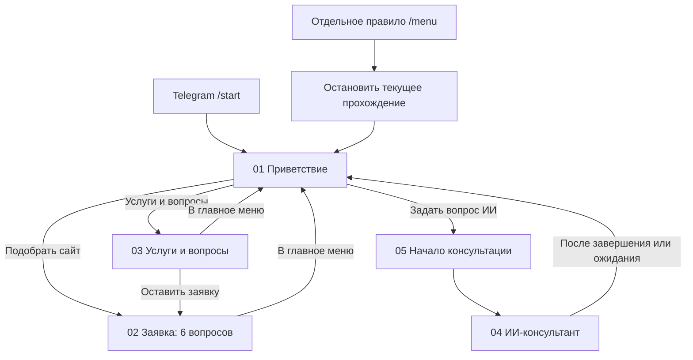
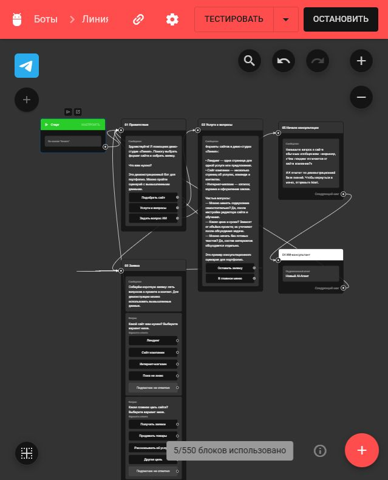

# «Линия» — Telegram-бот веб-студии

Демонстрационный проект для портфолио: бот помогает выбрать формат сайта, собирает заявку и консультирует с помощью встроенного AI-агента BotHelp.

**[Открыть бота в Telegram](https://t.me/liniya_studio_demo_bot)**

## Что умеет

- Показывает меню: «Подобрать сайт», «Услуги и вопросы», «Задать вопрос ИИ».
- Собирает шесть ответов: тип сайта, цель, бюджет, срок начала, имя и контакт.
- Сохраняет ответы в карточке подписчика BotHelp.
- Объясняет разницу между лендингом, сайтом компании и интернет-магазином.
- Отвечает по демонстрационной базе знаний на русском языке.
- Возвращает в меню по команде `/menu`.

Все сведения о студии вымышленные. Для проверки используйте вымышленные имя и контакт.

## Самостоятельное редактирование

Владелец кабинета BotHelp может без программирования менять тексты, кнопки, вопросы, варианты ответов, связи между шагами, инструкцию ИИ и базу знаний. Это позволяет заказчику обслуживать сценарий самостоятельно.

## Что находится в репозитории

Проект работает в визуальном конструкторе BotHelp. Здесь опубликованы сценарий, тексты, настройки ИИ, схема и инструкция по воспроизведению. **Это документация no-code проекта, а не автономная Python-программа и не официальный экспорт BotHelp.** Клонирование репозитория само по себе не запускает Telegram-бота.

| Файл | Назначение |
| --- | --- |
| [docs/scenario.md](docs/scenario.md) | Пять шагов, тексты, кнопки и вопросы |
| [docs/setup.md](docs/setup.md) | Подключение и ручная сборка в BotHelp |
| [docs/editing.md](docs/editing.md) | Что заказчик меняет самостоятельно |
| [docs/verification.md](docs/verification.md) | Проверенные возможности и список проверок |
| [ai/instructions.md](ai/instructions.md) | Инструкция AI-агента |
| [ai/knowledge-base.md](ai/knowledge-base.md) | Демонстрационные сведения для консультаций |
| [assets/bothelp-flow.jpg](assets/bothelp-flow.jpg) | Снимок схемы при сборке |

## Схема

## Статус и ограничения

Сценарий создан и активирован 13 октября 2026 года. Сохранение полей подтверждено в карточке подписчика; 14 октября владелец подтвердил работу бота после исправлений ИИ-ветки. Это не заменяет полный тест всех сочетаний действий.

CRM, внешние таблицы, платежи и уведомления реальному менеджеру в эту версию не подключены. Бот собирает заявку на сайт; сам сайт не создаёт. Поиск по всему интернету не настроен. Непрерывная работа зависит от кабинета и подписки BotHelp.

В репозитории нет токена Telegram, паролей, переписок или реальных заявок. Токен подключается непосредственно в BotHelp.

## Технологии

Telegram · BotHelp · визуальный редактор сценариев · встроенный AI-агент · текстовая база знаний · поля подписчика.

## Снимок редактора

Снимок показывает устройство сценария при сборке. Актуальная команда возврата описана в документации: `/menu`.
